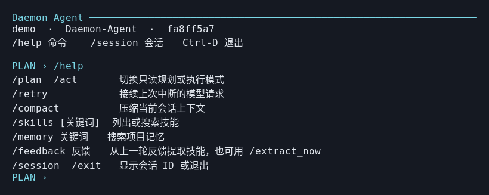

# Daemon Agent

本分支面向港科广实验室的夜间科研任务。可以从实验计划、作业记录和评测文件生成可追溯的晨报。

一个可在本地运行的 Python Agent。模型决定下一步调用哪个工具，运行时负责参数检查、操作审批、预算和持久化。每次读取、编辑与重试都有记录可供检查。核心仅依赖 Python 3.10+ 标准库，支持 Linux 和 macOS。



获取此分支：

```bash
git clone --branch feat/daemon-agent https://github.com/QuincyQAQ/foldjay-agent.git daemon-agent
cd daemon-agent
```

## 实验晨报

在项目根目录运行以下命令。示例使用合成记录，可在 CPU 上离线复现。

```bash
./daemon-agent.sh morning-report examples/overnight
```

`experiment.json` 列出两个对照组、预期的 seeds 和统一的评测场景。每个 `组/seed/` 目录提供 `job.json` 和 `eval.json`。两组都记录了作业完成、组名与 seed 及场景匹配、分数有效时，才列出配对结果。示例中 B 组 seed 2 缺评测，晨报列出两对分数和六项核验依据。加 `--json` 可导出结构化结果。交互模式可让 Agent 调用同一只读工具 `morning_report`。输入格式见 [样例](examples/overnight)。

## Slurm 夜间值守

在有 `sbatch`、`squeue`、`sacct` 和 `scontrol` 的登录节点运行，工作区与状态目录须位于计算节点也能访问的共享文件系统上。下面的命令授权一次合成数据回放，预算为一个 CPU 核、512 MiB、两分钟。分区和 QoS 按自己的集群设置。

```bash
./daemon-agent.sh overnight start first-night examples/overnight \
  --script examples/overnight/replay.sh --partition i96m3tu --qos i96m3tu \
  --cpus 1 --mem-mib 512 --minutes 2
./daemon-agent.sh overnight status first-night
nohup ./daemon-agent.sh overnight watch first-night > first-night.log 2>&1 < /dev/null &
```

`start` 会固定计划、脚本内容和资源参数，为这次运行创建新的输出目录。在其中用 Bash 执行你指定的脚本；脚本通过 `DAEMON_INPUT_DIR` 访问原始输入。预算适用于此次 Slurm 分配。请选用受信任的脚本。示例复制合成记录，实际实验脚本应按同一格式写入各组的作业和评测结果。

`first-night` 是你选定的运行标识。恢复时沿用同一标识和状态目录。程序先持久化唯一作业名，再提交；回复中断时，通过当前集群、用户及唯一作业名核对队列和结算记录。调度器暂未显示作业时返回 `AWAITING_CONFIRMATION`。若长时间处于该状态，可用 `status` 输出的 `token` 查询调度记录，确定是否收单后再决定是否另开运行。

`watch` 在作业结束后写出 `.foldjay/overnight/first-night/report.txt` 和 `report.json`。重新登录后运行同一条 `watch` 即可继续。作业失败、非零退出或计划损坏会记录到报告；进程返回非零。作业正常结束但缺少部分评测时，晨报列出缺失项和其余有效配对。

## 三分钟演示

在本分支的项目根目录运行离线演示和测试。

```bash
./daemon-agent.sh demo
cat .foldjay/demo/latest-report.json
./scripts/check.sh
```

演示会在独立目录中真实创建一个文件，读取 SHA-256，按哈希编辑并复读。报告中的 `file_content` 应为 `"Verified Daemon Agent\n"`，`resumed` 应为 `true`。同一份报告还包含从反馈生成的技能、评测与选定版本，以及独立探索子会话的 ID。演示的模型决策由确定性脚本提供，面试现场无需账号、网络或密钥。

## 三个值得跟踪的执行路径

| 问题 | 从哪里开始读 | 可以验证什么 |
| --- | --- | --- |
| 多个智能体如何共享有限步数？ | [主循环与委派](foldjay/agent.py) | 父任务派发工具、子任务执行、父任务总结都消耗预算。Plan 模式和递归深度限制沿委派生效。 |
| 工具已执行，模型超时怎么办？ | [会话检查点](foldjay/storage.py) · [上下文折叠](foldjay/context.py) | 工具结果逐个落盘；重试沿用这些结果。若进程恰好在执行和保存之间中断，会话将结果标记为未知，留待检查。 |
| 用户反馈怎样变成可复用的操作步骤？ | [技能生命周期](foldjay/skills.py) · [检索](foldjay/retrieval.py) | 上一轮任务、回答和反馈生成候选技能。技能有版本与来源，有标签的回放样本可以用于规则或模型评分。 |

[架构图与设计取舍](docs/ARCHITECTURE.md) · [功能与测试对照](docs/REQUIREMENTS.md) · [权限与故障排查](docs/OPERATIONS.md)

## 使用模型和工具

从源码运行时使用 `./daemon-agent.sh`。要安装 `daemon-agent` 命令和模型适配器，在虚拟环境中运行：

```bash
python -m pip install '.[models,ui]'
daemon-agent doctor
```

OpenAI 或 Chat Completions 兼容端点使用 `FOLDJAY_PROVIDER=openai`、`FOLDJAY_MODEL`、`OPENAI_API_KEY`。自定义地址由 `OPENAI_BASE_URL` 指定。Anthropic Messages 使用 `FOLDJAY_PROVIDER=anthropic`、`FOLDJAY_MODEL`、`ANTHROPIC_API_KEY`，可选 `ANTHROPIC_BASE_URL`。环境设置见 [.env.example](.env.example)。学校网关有单独的[接入指南](docs/CAMPUS_API.md)。

```bash
./daemon-agent.sh run --mode plan "从 README 和入口代码说明程序如何启动"
./daemon-agent.sh run --mode act
./daemon-agent.sh sessions
./daemon-agent.sh run --resume SESSION_ID --retry
```

安装 `ui` 后，交互终端会显示模型、当前模式和工具进度，并排版 Markdown 回复。可用 `./campus.sh run --plain` 切回文本界面；管道和单次任务沿用文本输出。

Plan 允许只读检查。Act 在每次写入、运行命令或调用外部 MCP 工具前请求批准。REPL 支持 `/plan`、`/act`、`/compact`、`/retry`、`/memory`、`/skills` 和 `/help`。使用 `--workspace`、`--state` 时将它们放在子命令前。会话、工具输出和记忆保存在本地 `.foldjay/`；使用远端模型时，任务及相关上下文会发送到所配置的服务。

已有 Bear Harness 工作区可继续运行原来的 `./campus.sh`，原会话、技能和校园凭据沿用 `.bear/`。新工作区默认使用 `.foldjay/`。旧版 `bear`、`bear.sh` 和模型配置 `BEAR_*` 仍可使用，新的 `FOLDJAY_*` 设置优先。Python 导入使用 `foldjay` 命名空间。

## 记忆、技能和 MCP

```bash
./daemon-agent.sh memory add --kind preference '项目文档使用中文'
./daemon-agent.sh memory search '文档'
./daemon-agent.sh skills add --title '可靠文件编辑' --file examples/editing-skill.md
./daemon-agent.sh eval SKILL_ID --cases examples/replay-cases.json
./daemon-agent.sh skills promote EVALUATION_ID
./daemon-agent.sh run --mcp-config examples/mcp.json
```

用 `skills replays SKILL_ID > cases.json` 导出反馈样本，填写其中的 `expected_terms` 后可传给 `eval --cases cases.json`。晋升要求评测对应当前已保存版本，分数至少为 0.8。该分数衡量工作流对样本的覆盖。MCP 示例通过 stdio 子进程提供词数统计；交互时需分别批准服务启动和工具调用。

## 容器和自动化验证

```bash
docker build --target core -t daemon-agent:local .
docker run --rm daemon-agent:local demo
```

[GitHub Actions](.github/workflows/test.yml) 定义了 Python 版本矩阵、安装包冒烟测试、模型 SDK 协议测试和 Docker 构建运行检查。Compose 使用非特权用户、只读根文件系统和可写工作区。Shell 和 MCP 运行在当前操作系统用户的权限下，部署不受信任的任务时应使用专用用户或容器。
