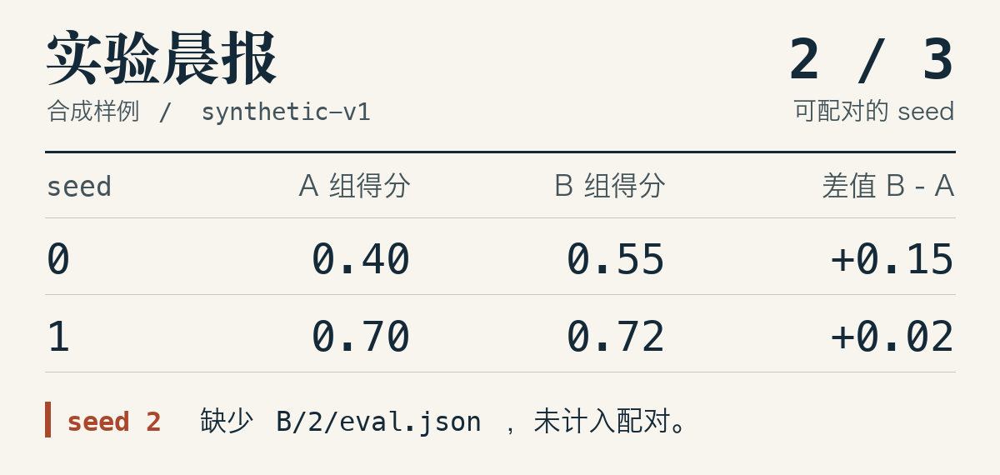

<h1 align="center">Daemon Agent</h1>

<p align="center">
  <strong>夜里值守 Slurm 作业，清晨核对实验结果。</strong><br>
  为港科广实验室开发的本地 Python Agent
</p>

<p align="center">
  <a href="#快速开始">快速开始</a> ·
  <a href="#实验晨报">晨报示例</a> ·
  <a href="docs/USAGE.md">使用指南</a> ·
  <a href="docs/ARCHITECTURE.md">架构设计</a>
</p>

<p align="center">
  <a href="pyproject.toml"></a>
  <a href="https://github.com/QuincyQAQ/daemon-agent/actions/workflows/test.yml?query=branch%3Amain"></a>
</p>

<p align="center">
  
</p>

## 它能帮你做什么

| 实验室里的问题 | Daemon Agent 怎么做 |
| --- | --- |
| 哪些 GPU 可以申请？ | [查询集群显卡](docs/USAGE.md#查看-slurm-集群显卡)，按型号和分区筛选当前空闲候选。 |
| 断开终端后，怎么接着看昨晚的作业？ | [用运行标识恢复值守](docs/USAGE.md#slurm-夜间值守)，核对 Slurm 队列和结算记录，作业结束后写出报告。 |
| 两组实验的哪些结果可以比较？ | [生成实验晨报](#实验晨报)，按 seed 配对分数，逐项列出缺失记录及原始文件。 |
| Agent 读了什么，又改了什么？ | [在终端查看工具调用](docs/USAGE.md#使用模型和工具)。Plan 模式只读，Act 模式在写入或执行命令前请求批准。 |

## 快速开始

在 Linux 或 macOS 上用 Python 3.10+ 跑一个合成实验。下载源码后，示例可离线运行，无需 GPU、Slurm 或模型密钥。

```bash
git clone https://github.com/QuincyQAQ/daemon-agent.git
cd daemon-agent
./daemon-agent.sh morning-report examples/overnight
```

## 实验晨报

样例计划比较 A、B 两组在同一场景下的三个 seed。两组都有完整且匹配的作业记录和有效评分时，晨报才列出这一对分数。

<p align="center">
  
</p>

想复核一项结果？打开 [B 组 seed 2 的目录](examples/overnight/B/2)，可以看到作业记录 `job.json`，但缺少评测 `eval.json`。晨报会标出这个缺口，其余两对分数仍然可用。给命令追加 `--json` 即可读取结构化结果。

## 在集群上值守一晚

1. **选资源。** 在登录节点运行 `./daemon-agent.sh gpus --free`，查看 GPU 候选及所属分区。
2. **提交实验。** 用 `overnight start` 指定运行标识、脚本、分区和资源预算。Agent 为这次运行建立独立的输出目录。
3. **收晨报。** 用同一标识运行 `overnight watch`。作业结束后会写出 `report.txt` 和 `report.json`；重新登录后也能继续跟踪。

[查看完整提交命令及恢复示例 →](docs/USAGE.md#slurm-夜间值守)

## 深入使用

- [三分钟离线演示](docs/USAGE.md#三分钟演示) · 看一次真实的文件编辑、哈希校验和会话恢复。
- [模型与校园网关](docs/USAGE.md#使用模型和工具) · 配置交互终端、模型提供方或[校园 API](docs/CAMPUS_API.md)。
- [运行时架构](docs/ARCHITECTURE.md) · 了解工具审批、共享步数预算、会话检查点和技能评测。
- [功能与测试对照](docs/REQUIREMENTS.md) · [权限与故障排查](docs/OPERATIONS.md) · [容器运行与验证](docs/USAGE.md#容器和自动化验证)
