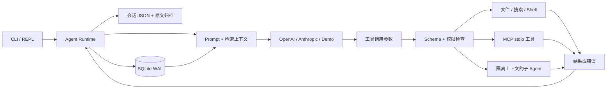
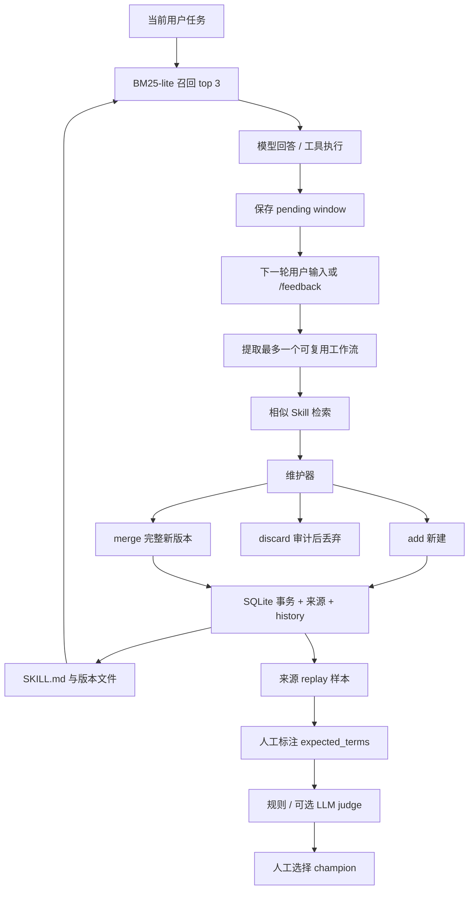

# 架构与实现

## 总体链路



`Agent` 统一协调，`Provider` 只实现 `complete(messages, tools) -> assistant message`，`Tools` 只执行注册工具，`Policy` 单独判定。内部采用 Chat Completions 形状的消息；Anthropic 适配器把 assistant 工具调用和 tool 结果转换为 `tool_use`/`tool_result`，连续工具结果合并到同一 user message。

实现参考：[OpenAI function calling](https://developers.openai.com/api/docs/guides/function-calling)、[Anthropic tool call handling](https://platform.claude.com/docs/en/agents-and-tools/tool-use/handle-tool-calls)。适配器支持普通文本及函数调用；不实现多模态内容、thinking blocks、流式事件或 provider 专有服务器工具。

## 运行预算和持久化

每轮 `run` 创建共享预算。一次主/子模型推理和一次工具分发各消耗 1，最多接受 16 个工具调用构成的批次。每层在委派前为自己的最终回答留出一步，子任务只能使用其余步数。预算不足以启动子任务时，父任务获得工具错误并仍可总结。默认最多递归两层，工具按顺序执行。Skills 提取/维护最多两个辅助模型调用；一次压缩最多一个辅助模型调用，这些不属于行动步数预算，仍受到 SDK 请求超时/重试限制。

先保存 assistant 调用，再按调用顺序逐个执行与保存结果。如果进程在执行后、保存前中断，恢复时无法确定副作用是否已发生，因此补充“outcome unknown”结果，要求模型先检查实际状态。没有 exactly-once 保证，也不自动重放未确认操作。

会话用文件锁防止同一会话被多个进程同时运行；JSON 临时文件写入、fsync 后原子替换。SQLite WAL 记录记忆、Skills、版本、来源事件、replay、评测、champion。不同会话仍可能同时修改同一工作区，不能把会话锁当成文件级协作锁。

## 上下文折叠

触发条件：历史、工作状态和基础系统提示的字符估算超过 `--context-chars`（默认 128,000 字符）、连续三个工具失败、模型调用 `compact` 或用户 `/compact`。工具批次完成后才折叠，避免 tool_result 与 tool_call 被拆开。

先归档完整旧消息，然后提取以下状态：

- `goal`：当前任务。
- `episodic`：近期阶段结果。
- `working_memory`：当前策略、约束和待办。
- `tool_memory`：工具结果、失败与注意事项。
- `tool_evidence`：从真实文件工具结果独立提取的历史记录，包含读取路径、偏移、哈希、是否截断、限长摘录与结构提纲，以及目录列表或成功写入记录。模型摘要不能覆盖该字段。

自动字符容量压缩使用确定性历史记录，不额外请求模型摘要；手动压缩和失败整理可请求结构化摘要，无效输出或服务失败退回近期摘录。优先保留最近的完整工具调用/结果对，保留预算根据工作状态大小动态计算；不会因整个批次超过 16,000 字符就将其整体丢弃。相同路径、范围的历史读取优先保留最新版本。归档保存折叠前的消息。单次读取的 JSON 超过传输上限时，消息保存可续读的前缀、全文哈希和读取长度；其余正文须按偏移从文件中继续读取。字符阈值不是精确 token 限制，保留预算不足时仍可能丢失正文细节。

重复读文件时仍先检查权限并实际读取，确认哈希和正文完全一致，且之前的同范围正文仍在可见历史中，才返回短提示并发出 `read_reused`。文件已变化或正文已经被压缩移除时返回完整新结果，不凭缓存声称内容没变。

`tool_evidence` 会同时提供给压缩模型和后续执行模型，因此摘要失败也不会只剩最后几个文件的片段。最多保留 80 项且记录序列化不超过 28,000 字符，超限先缩短摘录，再移除较旧记录并记录遗漏数量。它证明历史操作发生过，不保证文件当前未变化，也不保存完整正文；缺少记录不能推出“从未读取”。修改前仍应重新读取。

旧版已压缩会话在加载时，会从本状态目录内、属于同一会话 ID 的归档重建这份记录；不跟随模型给出的任意 archive 路径或归档符号链接。已迁移会话不重复扫描归档。

## Skills 自进化



Memory 存事实与偏好；Skills 存触发条件、操作步骤及验证方式。检索用 ASCII 单词及连续汉字 bigram，不依赖 embedding。每轮重建检索上下文。容量紧张时，先保留所有召回条目的 ID，再按 JSON 转义后的长度分配标题和正文摘录的空间。模型可以用 ID 获取完整的技能。

新 Skill 可直接被后续任务召回；质量评测是独立治理环节，并非上线前强制门禁。`--no-evolution` 可关闭在线沉淀。champion 是版本选择记录，当前检索仍使用最新 active 版本；需要回退时将历史文件作为 `skills merge --file` 导入，形成新的审计版本。

## MCP

实现固定版本的 [stdio transport](https://modelcontextprotocol.io/specification/2025-06-18/basic/transports) 与 [lifecycle](https://modelcontextprotocol.io/specification/2025-06-18/basic/lifecycle)：

1. 用户批准本地 argv 进程启动。
2. 发送 `initialize`，检查协商版本，再发 `notifications/initialized`。
3. `tools/list` 分页发现，命名为 `mcp_SERVER_TOOL`。
4. 每次调用均经过外部操作审批，再发 `tools/call`。
5. 后台线程读取逐行 JSON，主线程按 ID 等待响应，忽略通知；支持 ping，其余 server request 返回 method-not-found。
6. EOF/超时返回错误；关闭 stdin、等待并清理进程组。

客户端不把 server 的 `readOnlyHint` 当成权限保证。内置工具使用有限 JSON Schema 校验；外部复杂 schema 最终由 MCP 服务校验。工具名称冲突或过长会明确拒绝注册。

## 状态目录

```text
.bear/
  bear.sqlite3              # 权威结构化存储
  sessions/
    SESSION_ID.json         # 工作区、消息、pending、结构化状态
    SESSION_ID.lock         # 会话锁
    archives/*.json         # 压缩前完整原文
  skills/SKILL_ID/
    SKILL.md                # 当前版本的可读投影
    metadata.json           # 导出时的版本/状态/计数
    history/1.md            # 历史版本全文
  demo/
    latest-report.json      # 最近一次离线集成报告
    RUN_ID/                 # 独立演示工作区
```

运行时状态可能包含用户任务、源文件内容和工具输出，不加密。应将 `.bear/` 留在受控的本地磁盘并排除版本管理。
